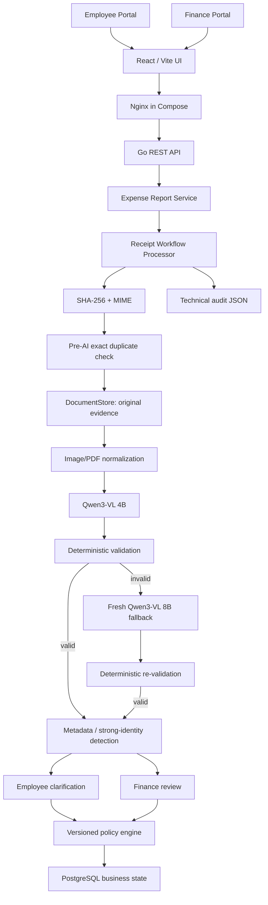

# Expense & Reimbursement Agent

AI-assisted expense processing with deterministic verification, duplicate/fraud controls, versioned reimbursement policy enforcement, PostgreSQL persistence, and separate Employee and Finance portals.

> **Core design principle:** the LLM understands and proposes; deterministic Go code verifies and enforces.

## Demo Video

A complete end-to-end demonstration of the Expense & Reimbursement Agent is available on YouTube:

**[Watch the End-to-End Demo](https://youtu.be/ULSZTEfE8H4)**

The demo covers multi-receipt processing, AI receipt extraction, deterministic validation, reimbursement policy enforcement, duplicate detection, employee clarification, cross-employee risk detection, Finance review, evidence comparison, and dynamic policy versioning.

## Why this project exists

A receipt-reading model can be useful for extracting merchant, date, totals, line items, and category. It should not be trusted to authorize money.

This project separates probabilistic document understanding from deterministic financial controls:

- vision models extract structured receipt data;
- Go validates arithmetic and required fields;
- duplicate/fraud controls compare binary and transaction identity;
- Finance resolves risky claims with evidence;
- a versioned policy engine determines reimbursement;
- PostgreSQL and audit records preserve the decision trail.

## Key capabilities

### Employee experience

- Submit one or more receipt/invoice files in an expense report.
- JPG, PNG, and PDF document support.
- View claimed vs reimbursable amounts.
- View receipt-level status and policy reason.
- Respond to duplicate clarification when required.
- Browse report history.
- Inspect technical details on demand.

### Finance experience

- Review reports that need attention.
- Inspect duplicate/fraud signals and confidence.
- Compare current and matched historical receipt evidence side by side.
- View merchant, date, receipt number, amount, employee, and matched claim.
- Approve a legitimate reviewed claim and re-apply the active deterministic policy.
- Reject a claim with zero reimbursement.
- Require reviewer identity and review note.
- View business event history.
- Create, edit, publish, and inspect versioned reimbursement policies.

### Risk and control

- SHA-256 exact duplicate pre-check before AI.
- Metadata matching for modified/re-encoded receipts.
- Strong identity detection using receipt number + date + amount.
- Same-employee and cross-employee risk handling.
- Zero automatic reimbursement for Finance-gated cases.
- Fresh larger-model fallback only when deterministic validation rejects the primary extraction.
- Immutable historical policy versions after publication.
- Original evidence retained separately from technical audit JSON.

## High-level architecture



## Technology stack

| Layer | Technology | Role |
|---|---|---|
| Frontend | React + Vite | Employee and Finance portals |
| Reverse proxy | Nginx | Serves production UI and proxies API |
| Backend | Go | Workflow, validation, fraud controls, policy enforcement |
| Database | PostgreSQL 16 | Claims, reports, events, policy versions/rules |
| AI runtime | Ollama | Local vision-model inference |
| Primary model | `qwen3-vl:4b-instruct` | Receipt extraction |
| Fallback model | `qwen3-vl:8b-instruct` | Fresh retry after failed deterministic validation |
| Evidence | Local content-addressed DocumentStore | Original receipt/invoice files |
| PDF rendering | Poppler / `pdftoppm` | PDF page conversion for vision input |
| Deployment | Docker Compose | Reproducible app stack |
| Audit | JSON + business event history | Technical and lifecycle traceability |

See [docs/TECH_STACK.md](docs/TECH_STACK.md) and [docs/ARCHITECTURE.md](docs/ARCHITECTURE.md).

## Quick start — recommended Docker Compose deployment

### Prerequisites

- Docker Desktop / Docker Engine with Compose v2
- Ollama running on the host
- required models:

```bash
ollama pull qwen3-vl:4b-instruct
ollama pull qwen3-vl:8b-instruct
```

### Start

```bash
./scripts/docker-preflight.sh
docker compose up --build -d
docker compose ps
./scripts/docker-smoke-test.sh
```

Open:

```text
Frontend: http://localhost:5173
API:      http://localhost:8080
Ollama:   http://localhost:11434
```

The Compose deployment runs PostgreSQL, the Go API, and the frontend/Nginx container. Ollama remains on the host so Apple Silicon can use native Metal acceleration.

Full instructions: [docs/DEPLOYMENT.md](docs/DEPLOYMENT.md).

## Local development

PostgreSQL:

```bash
docker run --name expense-agent-postgres \
  -e POSTGRES_USER=expense_agent \
  -e POSTGRES_PASSWORD=expense_agent_dev_password \
  -e POSTGRES_DB=expense_agent \
  -p 5432:5432 \
  -d postgres:16
```

Backend:

```bash
set -a
source .env
set +a

go run ./cmd/api
```

Frontend:

```bash
cd web
npm install
npm run dev
```

## Default seeded policy

A fresh database seeds the published `NovaTech Demo Expense Policy` version 1 in USD.

For employee grade `B2`:

| Category | Allowed | Maximum |
|---|---:|---:|
| Meals | Yes | $50 |
| Transportation | Yes | $100 |
| Accommodation | Yes | $250 |
| Travel | Yes | $500 |
| Office Expense | Yes | $150 |
| Internet | Yes | $60 |
| Mobile | Yes | $60 |
| Entertainment | Yes | $75 |

Finance can create a new draft, modify rules, and publish a new active version without rebuilding or restarting the API.

## Important API routes

| Method | Route | Purpose |
|---|---|---|
| GET | `/healthz` | Health check |
| POST | `/api/v1/expenses/analyze` | Legacy/single expense processing |
| POST | `/api/v1/expense-reports` | Create multi-receipt report |
| GET | `/api/v1/expense-reports/{reportID}` | Report detail |
| GET | `/api/v1/employees/{employeeID}/expense-reports` | Employee report history |
| GET | `/api/v1/admin/expense-reports` | Finance report queue |
| GET | `/api/v1/claims/{claimID}` | Claim detail |
| GET | `/api/v1/claims/{claimID}/events` | Claim business-event timeline |
| GET | `/api/v1/claims/{claimID}/document` | Original receipt evidence |
| POST | `/api/v1/claims/{claimID}/clarifications` | Employee clarification |
| POST | `/api/v1/admin/claims/{claimID}/review` | Finance approve/reject |
| GET | `/api/v1/admin/policies` | Policy version history |
| GET | `/api/v1/admin/policies/active` | Active policy |
| GET | `/api/v1/admin/policies/{policyID}` | Policy detail |
| POST | `/api/v1/admin/policies` | Create draft |
| PUT | `/api/v1/admin/policies/{policyID}` | Update draft |
| POST | `/api/v1/admin/policies/{policyID}/publish` | Publish/activate draft |

See [docs/API_REFERENCE.md](docs/API_REFERENCE.md).

## Claim lifecycle

Receipt-level states include:

```text
APPROVED
LIMIT_EXCEEDED
NOT_ALLOWED
CURRENCY_MISMATCH
CLARIFICATION_REQUIRED
DUPLICATE_DETECTED
MANUAL_REVIEW
HUMAN_REVIEW_REQUIRED
REJECTED
```

Report-level states include:

```text
PROCESSING
ACTION_REQUIRED
REVIEW_REQUIRED
COMPLETED
PARTIALLY_REJECTED
REJECTED
```

## Testing

Backend:

```bash
go test ./cmd/... ./internal/...
```

Frontend:

```bash
cd web
npm run build
npm run lint
```

Compose:

```bash
./scripts/docker-preflight.sh
docker compose up --build -d
./scripts/docker-smoke-test.sh
```

The project deliberately uses `go test ./cmd/... ./internal/...` rather than `go test ./...` because the frontend dependency tree can interfere with Go package discovery.

See [docs/TESTING.md](docs/TESTING.md) and [docs/TEST_MATRIX.md](docs/TEST_MATRIX.md).

## Documentation

Start with [docs/INDEX.md](docs/INDEX.md).

| Document | Purpose |
|---|---|
| [ARCHITECTURE.md](docs/ARCHITECTURE.md) | System design and trust boundaries |
| [TECH_STACK.md](docs/TECH_STACK.md) | Technology choices |
| [FEATURES.md](docs/FEATURES.md) | Product feature inventory |
| [AI_DESIGN.md](docs/AI_DESIGN.md) | AI extraction, validation, and fallback |
| [WORKFLOW.md](docs/WORKFLOW.md) | End-to-end processing flow |
| [POLICY_ENGINE.md](docs/POLICY_ENGINE.md) | Versioned reimbursement policy |
| [DUPLICATE_FRAUD_CONTROL.md](docs/DUPLICATE_FRAUD_CONTROL.md) | Duplicate and risk model |
| [FINANCE_REVIEW.md](docs/FINANCE_REVIEW.md) | Human review workflow |
| [DATA_MODEL.md](docs/DATA_MODEL.md) | Persistence model |
| [API_REFERENCE.md](docs/API_REFERENCE.md) | REST endpoints |
| [SECURITY.md](docs/SECURITY.md) | Security model and production gaps |
| [DEPLOYMENT.md](docs/DEPLOYMENT.md) | Docker Compose deployment |
| [TESTING.md](docs/TESTING.md) | Automated and deployment testing |
| [TEST_MATRIX.md](docs/TEST_MATRIX.md) | Functional/E2E matrix |
| [ASSUMPTIONS_LIMITATIONS.md](docs/ASSUMPTIONS_LIMITATIONS.md) | Scope and limitations |
| [SUBMISSION_CHECKLIST.md](docs/SUBMISSION_CHECKLIST.md) | Final handoff checklist |

## Production evolution

The prototype intentionally keeps interfaces separable:

```text
Local DocumentStore  -> S3/object storage
Local Ollama         -> controlled inference service
Local PostgreSQL     -> managed PostgreSQL
Synchronous workflow -> queue + workers
Local audit JSON     -> immutable centralized audit store
Demo identity fields -> SSO / HR identity provider
Local admin access   -> authenticated RBAC
```

These changes can be made without changing the central trust model: AI extracts; deterministic controls authorize.
