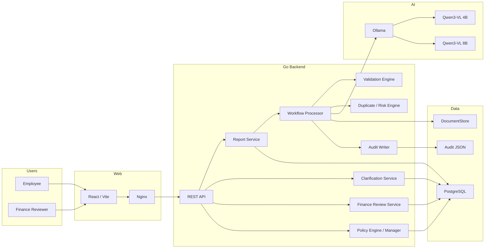
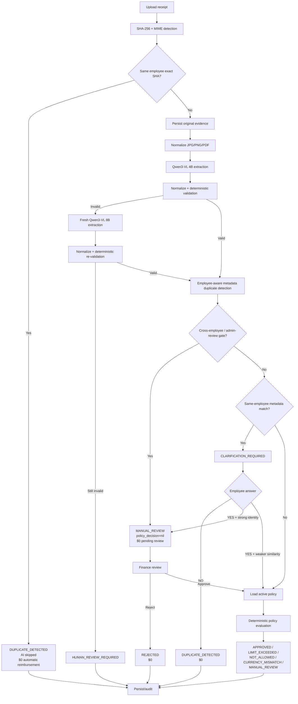
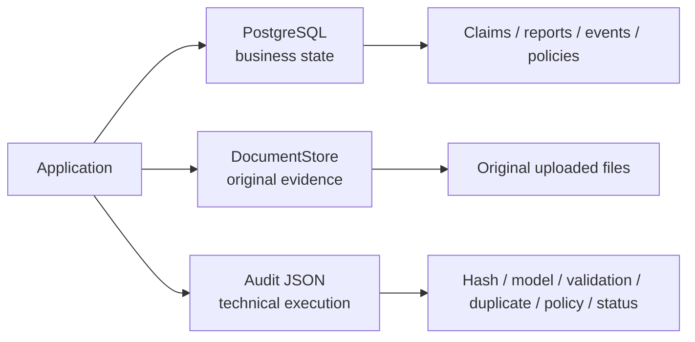
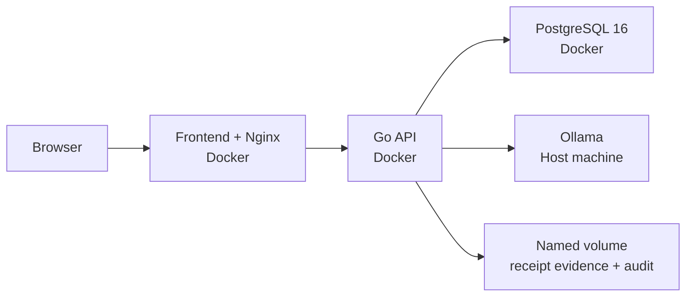

# Architecture

## Core design principle

> **LLM understands/proposes; deterministic Go code verifies/enforces.**

The model is an extraction component. It is not the policy engine, fraud authority, or reimbursement approver.

## Component architecture



## Receipt decision flow



## Trust boundaries

### AI trust boundary

AI is allowed to propose document facts:

- merchant;
- date;
- money fields;
- receipt number;
- payment method;
- category suggestion;
- line items;
- confidence/warnings.

AI is not allowed to make the final reimbursement authorization.

### Employee trust boundary

Employee clarification is input to the workflow, not an override.

A strong same-employee transaction identity cannot self-approve merely because the employee answers `YES`.

### Finance trust boundary

Finance determines whether a reviewed case is legitimate enough to continue or should be rejected.

Finance approval still goes through the active deterministic policy.

### Policy trust boundary

The reimbursement amount comes from a policy version and deterministic Go evaluation.

A published policy change affects future decisions without rewriting historical decisions.

## Persistence separation



This separation prevents technical execution records from being confused with business lifecycle state.

## Report aggregation

A report contains child claims.

Simplified parent status rules:

```text
Any CLARIFICATION_REQUIRED
-> ACTION_REQUIRED

Any MANUAL_REVIEW / HUMAN_REVIEW_REQUIRED / CURRENCY_MISMATCH
-> REVIEW_REQUIRED

Accepted + rejected mixture
-> PARTIALLY_REJECTED

All rejected
-> REJECTED

Otherwise all final
-> COMPLETED
```

`APPROVED` and `LIMIT_EXCEEDED` are accepted/final receipt outcomes.

## Deployment architecture



The recommended macOS/Apple Silicon deployment deliberately keeps Ollama on the host for native hardware acceleration.
