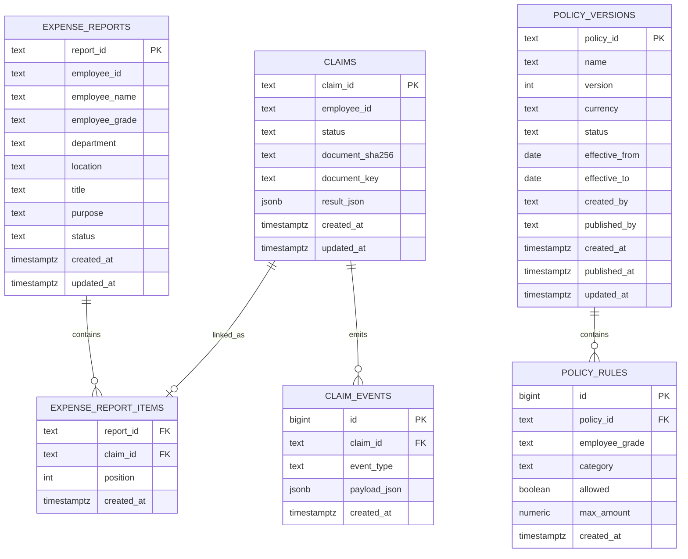

# Data Model

## Persistence domains

The system separates three types of data:

```text
PostgreSQL      -> business state
DocumentStore   -> original evidence
Audit JSON      -> technical execution evidence
```

## PostgreSQL entities



## `claims`

The `claims` table stores the current business representation of a receipt claim.

The detailed workflow result is preserved as `result_json`, while key search fields such as employee, status, hash, and document key are indexed separately.

## `claim_events`

Append-style lifecycle events provide a business-readable timeline.

Examples:

```text
CLARIFICATION_ANSWERED
CLAIM_STATUS_CHANGED
FINANCE_REVIEWED
```

## `expense_reports`

Parent object for a multi-receipt submission.

It stores employee snapshot fields plus title/purpose/status.

## `expense_report_items`

Links each child claim to exactly one report and preserves receipt position.

## `policy_versions`

Stores the version-level metadata and lifecycle:

```text
DRAFT
PUBLISHED
RETIRED
```

## `policy_rules`

Stores grade/category rules for each version.

Unique rule identity:

```text
policy_id + employee_grade + category
```

## DocumentStore

The original uploaded file is stored outside PostgreSQL.

The store is content-addressed and referenced from the claim through its document key.

Reasons:

- avoids putting large binaries in the transactional tables;
- preserves exact evidence;
- allows future replacement with S3/object storage.

## Technical audit JSON

The workflow also records technical execution information such as:

- run ID;
- SHA-256;
- MIME type;
- employee;
- primary/fallback model;
- extraction(s);
- validation result(s);
- duplicate result;
- clarification state;
- policy decision;
- final status.

This data is also used by the current prototype's historical duplicate detector.

## Production evolution

A production architecture can retain the same logical model while replacing:

```text
DocumentStore -> object storage
Audit JSON    -> immutable audit/event platform
PostgreSQL    -> managed PostgreSQL
```
