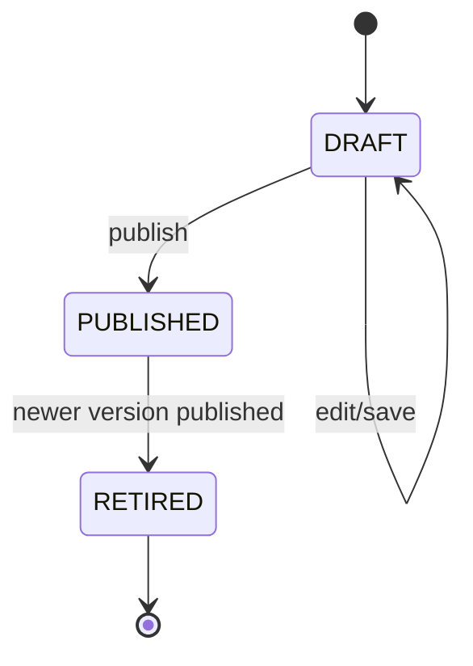

# Policy Engine and Policy Management

## Principle

Reimbursement is deterministic.

The model suggests a category, but the amount authorized comes from Go code using an active policy version.

## Policy structure

A runtime policy contains:

```json
{
  "policy_id": "POL-DEMO-USD-V1",
  "name": "NovaTech Demo Expense Policy",
  "version": 1,
  "currency": "USD",
  "limits": {
    "B2": {
      "Meals": {
        "allowed": true,
        "max_amount": 50
      }
    }
  }
}
```

## Baseline seeded policy

For a fresh database, version 1 is published automatically.

B2 USD limits:

| Category | Maximum |
|---|---:|
| Meals | 50 |
| Transportation | 100 |
| Accommodation | 250 |
| Travel | 500 |
| Office Expense | 150 |
| Internet | 60 |
| Mobile | 60 |
| Entertainment | 75 |

## Decision logic

Given a valid extraction and employee:

1. record employee/category/currency/claimed amount and policy identity;
2. reject to `CURRENCY_MISMATCH` if receipt currency differs from policy currency;
3. if no grade rule exists -> `MANUAL_REVIEW`;
4. if no category rule exists -> `MANUAL_REVIEW`;
5. if category is not allowed -> `NOT_ALLOWED`;
6. if amount is within the limit -> `APPROVED`;
7. if amount exceeds the limit -> `LIMIT_EXCEEDED`, reimbursing only the limit.

Example:

```text
B2 Meals limit = $50
Claim = $55.20

Status = LIMIT_EXCEEDED
Claimed = 55.20
Reimbursable = 50.00
Excess = 5.20
```

## Policy decision audit fields

Each policy decision records:

```text
policy_id
policy_name
policy_version
```

This preserves the exact policy context used for the financial decision.

## Version lifecycle



### DRAFT

- editable;
- does not affect claims;
- supports grade/category/allowed/max amount rules.

### PUBLISHED

- active when effective;
- used for new policy decisions;
- read-only in the Finance UI.

### RETIRED

- historical;
- no longer active;
- read-only.

## Publishing behavior

Publishing a draft:

- validates the policy;
- prevents future-dated activation before its effective date;
- retires the previously published policy;
- activates the new version;
- does not rewrite existing claim decisions.

## Active policy consumers

The same PostgreSQL-backed active policy source is used by:

- normal claim processing;
- policy processing after a weak duplicate clarification;
- Finance approval of a manual-review claim.

## Why this matters

A Finance reviewer can change policy safely without changing source code.

Example demo:

```text
Version 1: B2 Meals max = $50
$55.20 meal -> LIMIT_EXCEEDED -> $50

Publish Version 2: B2 Meals max = $60
new $55.20 meal -> APPROVED -> $55.20
```

The old claim remains tied to policy version 1.
